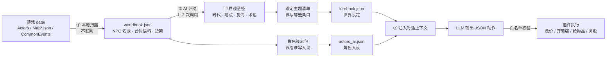

# Rpg-mz-mv-ai-

**RM_AI_NPC —— 给 RPG Maker MV / MZ 游戏装一层「AI 扮演 NPC」。**

装完之后，你在游戏里可以直接打字和 NPC 自由对话、讲价、偷窃、抢劫、切磋、送礼、住宿、加盟分红……
**没勾选的角色完全保持原版行为，插件不介入。**

- 引擎：RPG Maker **MV** / **MZ**（RPG Maker VX / VX Ace / XP 不支持）
- 当前版本：**v2.10.5**
- 平台：Windows 为主（游戏内功能跨平台，一键安装器仅 Windows）
- 不需要装 Node.js（一键安装器路线）；填写 API Key 后可**在游戏内**一键生成世界书 / 世界设定 / 角色设定

---

## 目录

- [这是什么](#这是什么)
- [30 秒上手](#30-秒上手)
- [它是怎么工作的](#它是怎么工作的)
- [核心特性](#核心特性)
- [安装](#安装)
- [游戏内怎么用](#游戏内怎么用)
- [配置](#配置)
- [AI 服务商](#ai-服务商)
- [仓库结构](#仓库结构)
- [常见问题](#常见问题)
- [卸载与还原](#卸载与还原)
- [隐私与安全](#隐私与安全)
- [版本历史](#版本历史)

---

## 这是什么

普通 RPG Maker 游戏里的 NPC 说的都是脚本写死的话，翻来覆去那几句。RM_AI_NPC 的做法是：

1. **扫描游戏自己的原作数据** —— 所有 NPC 的名字、台词、地图、商店货架、事件标签。全部本地完成，不联网。
2. **让 AI 归纳出这个世界** —— 世界观圣经、势力与地点、每个角色的身份与说话方式。数据来自**你安装的那款游戏自己的原作台词**，所以装到任何一款 MV/MZ 游戏上都成立，不会串味。
3. **把 NPC 交给大模型即兴扮演** —— 玩家自由打字，NPC 按自己人设、与你的交情、当前全镇名声回应，并能触发真实游戏效果：改价、开商店、给物品、回血、掉声望、甚至开打。

因为走的是**原生对话指令块**（101/401/102/402 + 355 回调），原版的消息窗口、选项窗口、跳过逻辑全部照旧 —— 和消息类插件天然兼容。

---

## 30 秒上手

```
1. 解压本仓库到任意位置（桌面就行，不用放进游戏目录）
2. 把你的【游戏文件夹】拖到「一键安装.bat」图标上松手
3. 启动游戏 → 任意界面按 F10 → 填 API Key
4. 菜单「AI 角色」→ 生成角色人设 / 生成世界设定 → 等它跑完
5. 勾选想交给 AI 扮演的 NPC → 去和它说话
```

没有 API Key 也能进游戏：会走**仿真模式**（离线固定套路），专门用来验证装没装通。

> 菜单找不到？**直接用 F10** —— 它不经过游戏输入系统，也不依赖任何菜单。

---

## 它是怎么工作的



关键设计：

- **LLM 只输出 JSON 动作，输出永不 eval。** 动作经白名单校验后才执行。
- **成败由插件掷骰，不由 LLM 宣布。** 偷窃 / 抢劫的成功率、代价、声望变化全在插件侧计算，模型只能提议。
- **讲价真的改价。** 直接改写 `Window_ShopBuy` 的成交价，不是嘴上说说。
- **状态存进 `$gameSystem`**，随存档走，读档兼容。

---

## 核心特性

### 对话

| 特性 | 说明 |
| --- | --- |
| 自由输入 | 玩家可以直接打字，不必从选项里挑 |
| 原作台词作开场白 | 保留原版台词，AI 在此基础上接话 |
| 吞掉原作选项分支 | 避免同一段对话被触发两次 |
| 「对方正在思考」小窗 | 可关闭 |
| 思考型模型兼容 | DeepSeek-R1 那类「思考 + 正文」共用 token 的模型已做余量处理 |
| 四语言 | 简体中文 / 繁體中文 / 日本語 / English，可自动识别游戏语言 |

### 世界书与资料馆

安装后**首次启动自动扫描原作数据**（本地、约 1 秒），把全游戏每个 NPC 的名录、每句台词、地图与货架整理成世界书。
菜单「AI 角色」→「世界书 / 角色」是个**资料馆**，可以翻这个游戏里所有人物的原作台词。

### 一键生成世界设定 / 角色设定

填完 API Key 后，游戏内点一下即可生成。没准备好会自动先跑前置流水线：

```
① 扫原作数据（NPC 名录 / 台词 / 地图）        —— 本地，约 1 秒
② 抽取全量语料（所有 NPC 的每句台词）          —— 本地
③ AI 归纳「世界圣经」（时代/地点/势力/人物/术语）—— 1 次调用
④ 给主角团挑人设线索                          —— 本地
⑤ AI 拟「世界设定主题清单」                    —— 1 次调用
⑥ 为每条主题找原作台词作依据                   —— 本地
```

前置流水线只在**第一次**跑，之后再点会跳过（想重跑：那一页按 `PgUp`）。
每步产物都会落盘到 `www/ai_npc/_lore/`，中途失败下次接着跑，不会从头再来。

### 玩法系统

| 系统 | 说明 |
| --- | --- |
| **偷窃** | 按物品价值分配几率，贵重物品难度加成；摸口袋按身份设上限（商人 / 旅馆 / 居民）；被抓扣声望与好感 |
| **抢劫** | 按「我方武力 − 对方武力」判定；得手洗劫整个货架、声望大幅下降、商人从此不做你生意（声望涨回可原谅） |
| **讲价** | 真的改写成交价，有次数限制与重置窗口；要价越狠越难谈；失败扣好感，还要乘性格的脾气系数 |
| **交情（好感度）** | **每个角色独有**。初始好感由全镇名声换算，靠「常来」慢慢堆 |
| **全镇名声** | 四档：过街老鼠 / 声名狼藉 / 小有名气 / 名满一方，直接影响物价与是否拒做生意 |
| **住宿** | 旅店老板可收钱让全队回满 HP/MP，住宿费同样受讲价影响 |
| **加盟投资** | 给商人投钱，按周期分红（按游戏运行时长计，关掉不计时） |
| **特色服务** | 按身份（铁匠 / 教会 / 学者 / 卫兵）追加服务，一次最多摆几条可配 |
| **任务加声望** | 用规则表挂开关 / 变量，**不用改游戏事件**即可让任务完成自动加声望 |
| **切磋 / 送礼** | 由 AI 按人设与关系决定怎么回应 |

---

## 安装

### 路线 A：一键安装（推荐，不需要 Node.js）

1. 把本仓库解压到**任意位置**（桌面就行，不用放进游戏目录）。
2. 找到你的**游戏文件夹** —— 里面有 `Game.exe`，还有一个 `www` 文件夹。
   把这个文件夹**拖到 `一键安装.bat` 的图标上**松手。

   拖的是哪个就装哪个。拖错了、或拖的目录里没有游戏，它会**直接报错停下**，不会去别处乱装。
   （拖的目录套了几层也没关系，只要下面 3 层内有 `www\data\System.json`。）

3. 另一种同样稳的用法：把仓库内容**直接解压进游戏文件夹**，然后在游戏文件夹里双击刚解压出来的 `一键安装.bat` —— 它一看「包就在游戏里」，二话不说就装这个游戏。

> ⚠️ 只把包解压在桌面、然后直接双击 `.bat`：如果电脑里只有一款这种游戏，它会问一句「装到这个吗」（回车即可）；如果有多款，它会把候选列出来让你**选编号** —— 它**不会**替你挑一个装上去。

它替你做完这些：

- 备份 `www/js/plugins.js` → `plugins.js.bak-日期时间`（出问题能还原）
- 把插件复制到 `www/js/plugins/RM_AI_NPC.js`
- 在 `$plugins` **末尾**注册插件（必须在最后，才能包住其他插件的钩子）
- 建好 `www/ai_npc/`，放上面板 + 配置模板 + 空白配置
- 把「一键生成」要用的脚本铺到 `www/ai_npc/tools/`，提示词模板铺到 `www/ai_npc/_lore/`

窗口顶部与结尾都会写明**「装到了：哪款游戏」**，核对一眼再进游戏。

### 路线 B：命令行（需要 Node.js）

```bash
node tools/install.js "D:/你的游戏根目录"
```

「游戏根目录」= `Game.exe` 所在的那一层。路径带空格要用英文双引号包起来。

```bash
# 卸载（保留数据）
node tools/install.js "<游戏根目录>" --uninstall

# 严格卸载（连文件一起删）
node tools/install.js "<游戏根目录>" --uninstall --purge --yes
```

### 路线 C：纯手工

1. 把 `RM_AI_NPC.js` 复制到 `<游戏>/www/js/plugins/`
2. 用记事本打开 `<游戏>/www/js/plugins.js`，在 `$plugins` 数组最后的 `]` 之前，给最后一条补个英文逗号，然后插入：

   ```json
   {"name":"RM_AI_NPC","status":true,"description":"AI NPC",
    "parameters":{"configPath":"ai_npc/config.json",
    "endpoint":"https://api.deepseek.com/chat/completions",
    "apiKey":"","model":"deepseek-chat","maxTurns":"8","debug":"false"}}
   ```

   ⚠️ 这一条**必须排在数组最后**。插件要最后加载，才能包住其他插件的钩子。
   ⚠️ 保存时选 **UTF-8** 编码，别存成 ANSI，否则中文描述会变乱码（不影响功能）。

3. 在 `<游戏>/www/` 下新建文件夹 `ai_npc`
4. 把 `config.template.json` 复制一份进去改名成 `config.json`；把 `tools/` 与 `_lore/` 下的文件按上面的结构铺好
5. 启动游戏 → 按 F10 填 API Key → 菜单「AI 角色」勾选 NPC

> 本仓库**没带任何成品数据**。装完进游戏第一次启动会自动扫原作数据；世界书 / 世界设定 / 角色设定，填完 Key 后在游戏内「AI 角色」菜单一键生成。

---

## 游戏内怎么用

| 操作 | 说明 |
| --- | --- |
| **任意时刻按 `F10`** | 打开图形化配置面板（改 Key / 换模型 / 调玩法参数） |
| `Esc` → 「AI 角色」 | `↑↓` 选人，`确定` 开关 AI，`PgUp` / `PgDn` 全开全关 |
| 对话中的选项 | 买东西 / 讲讲价 /（偷东西）/（动手抢）/ 自由发言 / 先走了 |
| 直接打字 | 「抢劫」「帮我打个折」「这个送我吧」都能被认出来 |
| 「AI 角色」→「世界书 / 角色」 | 资料馆，翻这游戏里所有人物的原作台词 |

**没勾选的角色一律保持原版，不会乱说话。**

### 插件命令

在事件里可以调用：

```
AinpcReload        重新读取 config.json
AinpcTest          发一次测试请求
AinpcStatus        输出当前状态
AinpcEnableAll     全部交给 AI
AinpcDisableAll    全部关掉
```

---

## 配置

配置放在 `www/ai_npc/config.json`。仓库里的 `config.template.json` 是**空白模板，不含任何 Key**。

**推荐直接在游戏里按 F10 面板改** —— 保存后不用重启游戏，下次和 NPC 搭话时会自动读取新配置。

面板支持：服务商一键切换、测试连接（真实发一次请求，失败会把服务端原文错误贴出来）、拉取模型列表、「仿真模式」开关。

### 配置速查表

| 分组 | 键 | 默认 | 说明 |
| --- | --- | --- | --- |
| 连接 | `provider` | `openai` | 兼容协议 |
| | `endpoint` | `https://api.deepseek.com/chat/completions` | |
| | `apiKey` | `""` | 留空 → **仿真模式**（不联网，验证链路用） |
| | `model` | `deepseek-chat` | |
| 对话 | `language` | `auto` | `auto` / `zh-CN` / `zh-TW` / `ja` / `en` |
| | `maxTurns` | `20` | 单次对话最多轮数 |
| | `temperature` | `0.85` | 越高越随性 |
| | `maxTokens` | `1600` | 单次回复上限 |
| | `jsonMode` | `true` | 建议开启，动作解析更稳 |
| | `allowFreeInput` | `true` | 允许玩家自由打字 |
| | `allNpcsTalkable` | `false` | 打开后世界书里所有 NPC 都能对话，不必逐个开 |
| | `keepOriginalText` | `true` | 保留原作台词作为开场白 |
| | `swallowChoices` | `true` | 吞掉原作选项分支 |
| | `showThinkingWindow` | `true` | 显示「对方正在思考」小窗 |
| | `merchantMode` | `shop` | 商人接管方式：`shop` / `talk` / `off` |
| 偷窃 | `allowSteal` | `true` | |
| | `stealBaseChance` | `0.45` | 基础成功率，再叠加幸运加成 |
| | `stealValueBias` | `0.8` | 正数 = 便宜的先被顺走 |
| | `stealValueHardness` | `0.5` | 贵重物品难度加成 |
| | `stealFailPenalty` | `8` | 被抓扣声望 |
| | `pocketMaxGoldMerchant` / `Inn` / `Resident` | `80` / `50` / `25` | 摸口袋上限 |
| 抢劫 | `allowRob` | `true` | |
| | `robBaseChance` | `0.5` | 再按武力差加减 |
| | `robPowerFactor` | `0.012` | 武力每领先 1 点加多少成功率 |
| | `robPenalty` / `robFailPenalty` | `35` / `22` | 得手 / 失手扣声望 |
| | `hostileForgiveRep` | `25` | 声望涨回这个值，被抢过的商人重新做生意 |
| 讲价 | `priceMinPercent` / `priceMaxPercent` | `50` / `150` | AI 报价会被夹在这个区间 |
| | `haggleBaseChance` | `0.45` | |
| | `haggleEffBonus` | `5` | 印象好能多谈几次 |
| | `haggleWindowSec` | `180` | 讲价次数重置窗口（秒） |
| | `haggleMinEffective` | `-30` | 低于这个印象连谈都不谈 |
| 交情 | `affInitFromRep` | `0.4` | 初始好感 = 全镇声望 × 系数 |
| | `praiseAffBonus` / `insultAffPenalty` | `8` / `10` | |
| | `stealAffPenalty` | `20` | 偷他被抓扣好感 |
| 名声 | `insultPenalty` / `praiseBonus` | `6` / `5` | 辱骂 / 夸奖 |
| | `repRules` | `[]` | 任务完成自动加声望的规则表，**不用改游戏事件** |
| 旅店 | `allowRest` | `true` | |
| 投资 | `investMinAmount` | `100` | 加盟最低金额 |
| | `investPeriodSec` / `investRate` | `300` / `0.08` | 分红周期与比例 |
| 特色服务 | `specialsExtra` | `true` | 按身份追加服务 |
| | `maxSpecialChoices` | `4` | 一次最多摆几条，太多会挤爆选项框 |
| 高级 | `timeoutMs` / `retries` | `30000` / `1` | |
| | `debug` | `false` | 开启后控制台打印详细流程 |

> 面板里的可调项比这张表更多（含 `maxStealQty`、`repVarId`、`enabledSwitchId`、`robTroopId`、各类价格系数与性格阈值等），按 F10 就能看到全部及每项的中文说明。

---

## AI 服务商

面板内置以下预设，也可以直接填任何 OpenAI 兼容端点：

| 预设 | Endpoint |
| --- | --- |
| DeepSeek | `https://api.deepseek.com/chat/completions` |
| OpenAI | `https://api.openai.com/v1/chat/completions` |
| 通义千问 | `https://dashscope.aliyuncs.com/compatible-mode/v1/chat/completions` |
| 智谱 GLM | `https://open.bigmodel.cn/api/paas/v4/chat/completions` |
| 月之暗面 | `https://api.moonshot.cn/v1/chat/completions` |
| 硅基流动 | `https://api.siliconflow.cn/v1/chat/completions` |
| 本地 Ollama | 指向本机地址即可 |

**用的是云端大模型，对话内容会发到对应服务商。介意的话用本地模型（endpoint 指向本地）。**

---

## 仓库结构

```text
Rpg-mz-mv-ai-/
├── RM_AI_NPC.js              # 插件本体（部署到 www/js/plugins/）
├── 一键安装.bat               # Windows 一键安装入口（可拖游戏文件夹进来）
├── _oneclick.ps1             # 一键安装的实际逻辑（ASCII 保护，避免代码页问题）
├── config.template.json      # 空白配置模板（不含任何 Key）
├── 安装说明.txt               # 完整手册（含全部版本历史与设计说明）
├── _lore/                    # 通用提示词模板（跨游戏共用，不含任何作品的专有名词）
│   ├── persona_prompt.json   #   角色人设提示词
│   ├── persona_sample.json   #   人设样板（few-shot 范例 + 质量基准）
│   ├── lorebook_prompt.json  #   世界设定提示词
│   ├── bible_prompt.json     #   世界观圣经提示词
│   └── topics_prompt.json    #   设定主题清单提示词
├── tools/                    # 安装器 · 配置面板 · 游戏内流水线
│   ├── install.js            #   命令行安装 / 卸载器
│   ├── scan_game.js          #   世界书扫描器（世界书 + 角色档案）
│   ├── extract_lore.js       #   全量语料抽取
│   ├── corpus_digest.js      #   语料摘要
│   ├── ai_schema.js          #   AI 产物规格与兜底
│   ├── persona_core.js       #   人设核心（提示词 / 调模型 / 写回）
│   ├── gen_bible.js          #   世界观圣经生成（AI）
│   ├── build_persona_input.js#   人设线索包组装
│   ├── gen_topics.js         #   设定主题清单生成（AI）
│   ├── build_lorebook_input.js # 世界设定线索包组装
│   ├── place_names.js        #   地名解析
│   ├── l10n.js               #   本地化占位符还原
│   ├── config-panel.html     #   图形化配置面板
│   ├── config-server.js      #   本地配置服务（只监听 127.0.0.1）
│   ├── panel-help.txt        #   面板使用说明
│   ├── 打开AI配置面板.bat / 打开配置面板.bat
│   └── test_parse.js / cmp_*.js / repro_persona.js / _probe_*.js  # 开发与自检脚本
└── docs/
    └── CHANGELOG.md          # 版本历史
```

### 部署后的目录结构

```text
<游戏根目录>/
├── Game.exe
└── www/
    ├── js/
    │   ├── plugins.js                  # 安装器会备份成 plugins.js.bak-日期时间
    │   └── plugins/RM_AI_NPC.js
    └── ai_npc/                         # 插件的数据目录
        ├── config.json                 # 你的配置（含 API Key，别外传）
        ├── startup.log                 # 每次启动重写的自检日志
        ├── worldbook.json              # 原作扫描产物：NPC 名录 / 语料 / 货架
        ├── actors_ai.json              # 角色人设
        ├── lorebook.json               # 世界设定
        ├── tools/                      # 游戏内一键生成要用的脚本
        └── _lore/                      # 提示词模板与流水线中间产物
```

---

## 常见问题

**插件到底加载没有？**
打开 `<游戏>/www/ai_npc/startup.log`（每次启动重写，第一手证据）。里面能看到：插件有没有加载、菜单项有没有注册、配置读没读到、有没有 JS 报错。

**菜单里没有「AI 角色」？**
插件没注册成功，或没排在 `$plugins` 最后。重跑一次 `一键安装.bat`。

**`一键安装.bat` 双击一闪而过？**
右键它选「以管理员身份运行」；或开个 cmd 窗口手动跑：

```bat
cd /d "<解压出来的包目录>"
一键安装.bat
```

**杀毒软件拦了 `.bat`？**
它只是不认识新脚本，放行一次即可。脚本只做三件事：备份 `plugins.js`、复制文件、在 `$plugins` 末尾加一条记录。

**「打开配置面板.bat」双击一闪而过？**
在 cmd 里手动跑一遍，报错就看得见了：

```bat
cd /d "<游戏目录>" && 打开AI配置面板.bat
```

**装错了想还原？**
把 `www/js/plugins.js.bak-日期时间` 覆盖回 `www/js/plugins.js` 即可。

**没填 Key 能玩吗？**
能。会走**仿真模式**（离线固定套路），专门用来验证装没装通。

**换一款游戏要重新生成吗？**
要。世界书 / 世界设定 / 角色设定是**在那款游戏里、用它自己的原作台词**现场生成的 —— 换游戏就在新游戏里重跑一次。

**插件本体更新了，`tools/` 要一起换吗？**
★ **必须同版本号一起换。** 只换插件不换 `tools/`，老引擎上的「一键准备」照样跑不起来。

---

## 卸载与还原

```bash
# 只卸载插件注册（保留 ai_npc 数据）
node tools/install.js "<游戏根目录>" --uninstall

# 连文件一起删
node tools/install.js "<游戏根目录>" --uninstall --purge --yes
```

手工方式：把 `www/js/plugins.js.bak-日期时间` 覆盖回 `www/js/plugins.js`，删掉 `www/js/plugins/RM_AI_NPC.js` 与 `www/ai_npc/` 即可。

---

## 隐私与安全

- 本仓库**不含任何人的 API Key**。`config.template.json` 的 `apiKey` 是空的。
- 你填完 Key 的那份 `config.json` 只留在自己机器的 `www/ai_npc/` 里，**别连它一起发出去**。
- 配置面板的本地服务**只监听 `127.0.0.1`**，不对外网开放。
- 用的是云端大模型，**对话内容会发到对应服务商**。介意的话把 endpoint 指向本地模型。
- LLM 输出的动作一律经**白名单校验**后执行，**永不 `eval`**；偷窃 / 抢劫成败由插件自己掷骰，模型无法自行宣布结果。
- 本仓库**不含任何商业游戏的素材**，只有插件源码、安装器与通用提示词模板。原作数据（角色、台词、地名）均由你在**自己安装的那款游戏**上现场扫描生成，不会随仓库分发。

---

## 版本历史

完整版本历史见 [`docs/CHANGELOG.md`](docs/CHANGELOG.md)，逐版说明（含每处 bug 的成因与修法）见 [`安装说明.txt`](安装说明.txt)。

近期版本：

| 版本 | 重点 |
| --- | --- |
| **v2.10.5** | 修掉 v2.10.4「关系修复」自己引入的 5 处 bug（最狠的一处把修复整个反转），补 23 项守门员断言 |
| v2.10.4 | 别把所有人都当陌生人 —— 关系分四层查下来 |
| v2.10.3 | 关系字段与初次见面分流 |
| v2.10.2 | 互动文本「对不齐 / 闪太快」+ 人设生成从 85 次请求降到 23 次 |
| v2.10.1 |「Ctrl 单独生成」按了没反应 |
| v2.10.0 | 汉化版游戏「人名 / 地名还是日文」+ 部分角色没有脸 |
| v2.9.x | 多语言游戏占位符还原、日/英文事件标签不再当人名、非人素材判据、老引擎兼容等 |

---

## 参与贡献

欢迎提 [Issue](https://github.com/mizhoudawang/Rpg-mz-mv-ai-/issues) 反馈**具体游戏上的具体问题** —— 报告时请附上：

1. 游戏名（或引擎版本 MV / MZ）
2. `www/ai_npc/startup.log`
3. `config.json` 里 `debug` 设为 `true` 后的控制台输出
4. 复现步骤：按了什么、看到什么、期望什么

> 提交前请**先删掉 `config.json` 里的 `apiKey`**。

---

## 许可

本仓库暂未附带开源许可证文件。在许可证补充之前，默认保留所有权利（All rights reserved）。

如果你打算在自己的项目里使用或再分发，请先通过 GitHub Issue 联系作者。
